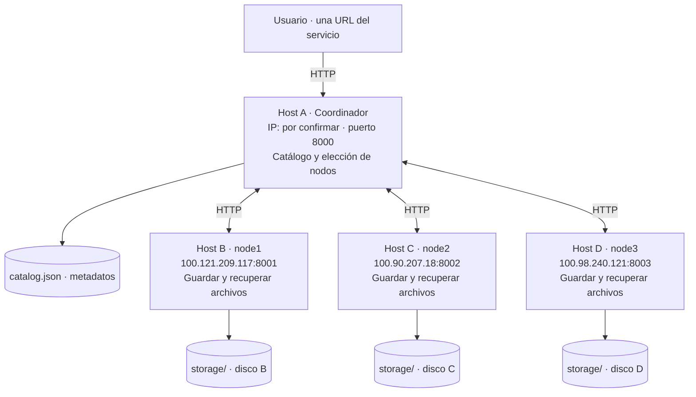

# Mini Drive Distribuido

Primer laboratorio de Sistemas Distribuidos (IS893), Universidad Tecnológica de Pereira. Grupo de cuatro integrantes.

El servicio permite **subir, listar y descargar archivos** desde un coordinador. Este reparte los archivos entre tres nodos, guarda dos copias y utiliza la réplica cuando falla la copia principal. El alcance está ajustado al *Taller Parcial – Laboratorio Sistemas Distribuidos, octubre de 2026*.

**La demostración evaluada debe ejecutarse en cuatro computadores independientes, con IP distintas.** Las pruebas en localhost incluidas aquí sirven para desarrollar y verificar el código; no sustituyen esa entrega.

## Arquitectura y distribución del trabajo



Las IP de nodos proceden de la configuración existente de Tailscale; su conectividad debe comprobarse en los equipos. Complete la IP del coordinador y el inventario de [la demostración](docs/DEMOSTRACION.md) antes de entregar.

| Componente | Responsabilidad |
| --- | --- |
| Coordinador | Recibir peticiones del cliente, elegir dos nodos, comprobar sus respuestas y registrar ubicaciones. |
| Cada nodo | Guardar una copia en su disco y entregarla por HTTP cuando se solicita. |
| Catálogo JSON | Relacionar nombre visible, identificador físico, tamaño, SHA-256 y ubicaciones. |
| Cliente | Utilizar la URL del coordinador sin elegir el nodo físico. Swagger UI permite hacerlo desde el navegador. |

## Decisiones del laboratorio

- Python y FastAPI para las API; HTTPX para las solicitudes entre procesos.
- HTTP/REST sobre LAN o Tailscale, permitido por la guía.
- Selección por turnos (*round-robin*): con todos activos, los pares son `node1–node2`, `node2–node3` y `node3–node1`.
- Dos copias antes de confirmar una subida; si un nodo falla, se intenta el siguiente.
- Descarga desde el principal y, si falla o entrega contenido incorrecto, desde la réplica.
- Catálogo JSON escrito mediante un temporal y sustitución al terminar, para evitar truncar el catálogo anterior.
- Un proceso coordinador y un proceso por nodo. El coordinador procesa una subida a la vez mediante un bloqueo local.
- Archivos de hasta 10 MiB por defecto. Las operaciones usan memoria; el límite mantiene sencilla la implementación.
- Nombres repetidos: `409`. Para un archivo nuevo, utilice otro nombre; esta versión no administra actualizaciones ni versiones.
- Sin autenticación, reparación de réplicas, auditorías periódicas ni tareas de mantenimiento.

Estas decisiones de implementación no son exigencias adicionales del profesor. Su justificación y la correspondencia con cada requisito están en [ALCANCE_LABORATORIO.md](docs/ALCANCE_LABORATORIO.md).

## Estructura

```text
common/
  config.py                 Configuración por variables de entorno
  files.py                  Validación, tamaño, hash y escritura con temporal
  schemas.py                Respuestas documentadas de la API
coordinator/
  catalog.py                Catálogo JSON y turno de distribución
  main.py                   Subir, listar, descargar y consultar estado
  services.py               Solicitudes HTTP a los nodos
node/
  main.py                   Arranque del servidor del nodo
  router.py                 Guardar y recuperar objetos del disco
scripts/
  test_connectivity.py      Consulta HTTP a coordinador y nodos
  migrate_catalog.py        Exportación opcional del SQLite anterior a JSON
tests/
  test_system.py            Pruebas aisladas de funcionamiento
  smoke_http.py             Cuatro procesos HTTP temporales
docs/
  ALCANCE_LABORATORIO.md     Análisis de la guía y simplificación
  DEMOSTRACION.md            Inventario y guion de evidencias en cuatro hosts
storage/                    Datos del nodo; excluidos de Git
.env.example                Plantilla; no se carga automáticamente
requirements.txt            Dependencias directas
```

Los paquetes `common`, `coordinator` y `node` incluyen `__init__.py`. Los documentos `DIAGNOSTICO.md`, `CORRECCIONES.md` y `LIMPIEZA.md` dentro de `docs/` se conservan como historial de las revisiones anteriores.

## Instalación

Python 3.12 es el entorno de referencia. La versión simplificada también se probó con Python 3.14.2 en Windows.

En cada computador, desde la raíz del repositorio:

```powershell
python -m venv .venv
.\.venv\Scripts\Activate.ps1
python -m pip install -r requirements.txt
```

Si ya existe `venv`, active `.\venv\Scripts\Activate.ps1`. Hay un solo archivo de dependencias: fija las cuatro bibliotecas directas; sus dependencias indirectas las resuelve pip.

## Ejecución en los cuatro equipos

En cada terminal, active el entorno virtual. Mantenga el mismo código en los cuatro equipos y configure las IP accesibles de los nodos en el coordinador.

**Host B — node1:**

```powershell
$env:NODE_ID="node1"
$env:NODE_PORT="8001"
python -m node.main
```

**Host C — node2:**

```powershell
$env:NODE_ID="node2"
$env:NODE_PORT="8002"
python -m node.main
```

**Host D — node3:**

```powershell
$env:NODE_ID="node3"
$env:NODE_PORT="8003"
python -m node.main
```

**Host A — coordinador:**

```powershell
$env:NODE1_URL="http://100.121.209.117:8001"
$env:NODE2_URL="http://100.90.207.18:8002"
$env:NODE3_URL="http://100.98.240.121:8003"
python -m coordinator.main
```

Sustituya esas direcciones si cambiaron en su red. El coordinador escucha en el puerto 8000. Desde el navegador de cualquier equipo que tenga acceso, abra `http://IP_COORDINADOR:8000/docs`.

Cada nodo utiliza su propio `storage/`. La pequeña identidad `.node.json` evita asignar accidentalmente ese directorio a otro `NODE_ID`. Si ya tiene datos, conserve el mismo identificador y directorio.

## Uso

Puede realizar las operaciones desde Swagger UI o desde PowerShell:

```powershell
$base="http://IP_COORDINADOR:8000"
curl.exe -F "file=@./informe.pdf" "$base/upload"
curl.exe "$base/files"
curl.exe -D "./cabeceras.txt" -o "./descargado.pdf" "$base/download/informe.pdf"
curl.exe "$base/status"
```

Sustituya `IP_COORDINADOR` y use un archivo que exista. La descarga incluye `X-Storage-Node`, que identifica el nodo que entregó el contenido y permite evidenciar el cambio a la réplica.

### API del coordinador

| Método | Ruta | Resultado |
| --- | --- | --- |
| GET | `/health` | Comprueba el coordinador y la lectura del catálogo. |
| POST | `/upload` | Multipart con `file`; responde `201` después de confirmar dos copias. |
| GET | `/files` | Lista metadatos y ubicaciones registradas. |
| GET | `/download/{filename}` | Recupera una copia válida y responde `200`. |
| GET | `/status` | Sondea los nodos e informa `UP` o `DOWN`. |

### API de cada nodo

| Método | Ruta | Resultado |
| --- | --- | --- |
| GET | `/health` | Identidad, ruta de almacenamiento y cantidad de objetos. |
| POST | `/store` | Guarda el objeto recibido y devuelve tamaño y hash. |
| GET | `/retrieve/{filename}` | Recupera el objeto físico del disco. |

El nombre visible del cliente puede ser `informe.pdf`, mientras el archivo físico es un identificador como `a73f...`. Esa relación aparece en `/files`, campo `storage_key`. Se usa un identificador nuevo por intento para evitar que una subida fallida altere otro archivo. El contenido guardado es el original, sin cifrado ni transformación.

Los errores principales son `400` (nombre inválido), `404` (archivo ausente), `409` (nombre repetido), `413` (tamaño excesivo), `422` (formulario incompleto) y `503` (catálogo o copias disponibles insuficientes). Codifique los nombres con espacios, `#`, `%` o Unicode al construir una URL.

## Configuración

Las variables se leen al arrancar cada proceso; `.env.example` no se importa automáticamente.

| Variable | Predeterminado | Uso |
| --- | --- | --- |
| `NODE_ID` | `node1` | Identificador del nodo. |
| `NODE_HOST` / `NODE_PORT` | `0.0.0.0` / `8001` | Interfaz y puerto del nodo. |
| `STORAGE_DIR` | `<raíz>/storage` | Directorio de datos del nodo. |
| `COORDINATOR_HOST` / `COORDINATOR_PORT` | `0.0.0.0` / `8000` | Interfaz y puerto del coordinador. |
| `NODE1_URL`, `NODE2_URL`, `NODE3_URL` | Direcciones de `common/config.py` | Ubicaciones HTTP de los nodos. |
| `CATALOG_FILE` | `<raíz>/catalog.json` | Catálogo del coordinador. |
| `MAX_FILE_SIZE` | `10485760` | Máximo por archivo: 10 MiB; mismo valor en los cuatro procesos. |
| `COORDINATOR_URL` | `http://127.0.0.1:8000` con el puerto configurado | URL que consulta el script de conectividad. |

Los tiempos de conexión y de espera de datos son 3 y 10 segundos, respectivamente. No representan un plazo total para toda la operación.

## Catálogo y actualización desde la versión anterior

El catálogo JSON se crea automáticamente. Un JSON dañado produce un error y se conserva para corregirlo; no se reemplaza por un catálogo vacío. Los JSON originales sin `storage_key` siguen utilizando sus nombres físicos anteriores.

Si llegó a utilizar la versión SQLite, detenga los procesos de esa versión y exporte antes de iniciar el nuevo coordinador:

```powershell
python scripts/migrate_catalog.py ./catalog.sqlite3 ./catalog.json
```

La exportación es de solo lectura sobre SQLite y rechaza un destino existente. Conserva los identificadores y ubicaciones de los archivos publicados. Si hay un JSON anterior, elija un destino nuevo y configure `CATALOG_FILE` con esa ruta; no sobrescriba los catálogos.

Las antiguas operaciones pendientes y las colas de limpieza no se importan. Las carpetas `.locks` y `.deleted` de una instalación anterior dejan de utilizarse; la nueva versión no las crea ni las elimina. `.node.json` sigue identificando el directorio.

Para respaldar esta versión, detenga el coordinador y copie `catalog.json`; respalde también los directorios de los nodos si necesita conservar los archivos.

## Verificación

```powershell
python -m unittest discover -s tests -v
python tests/smoke_http.py
python scripts/test_connectivity.py
```

Las **34 pruebas** utilizan directorios temporales y comprueban distribución, réplicas reales, fallos, hashes, persistencia, nombres duplicados, concurrencia básica, límites y compatibilidad de catálogos.

La prueba HTTP inicia tres nodos y un coordinador en puertos locales libres. Verifica los archivos físicos, detiene un nodo, descarga desde la réplica, detiene el coordinador, comprueba el acceso directo al nodo y reinicia el servicio con el mismo JSON. Al terminar cierra sus procesos y elimina sus datos.

El script de conectividad consulta procesos reales: ejecútelo con las URL del despliegue. Devuelve `0` si todos responden y `1` si alguno falla. Desde otro equipo, configure primero `COORDINATOR_URL` con la IP del coordinador.

En Python 3.14, la combinación de dependencias existente muestra avisos de deprecación y de recursos internos de TestClient/AnyIO durante la suite. Las aserciones y la prueba HTTP se revisan por separado; esos avisos no acreditan ni invalidan la conectividad entre los cuatro equipos.

## Límites que deben explicarse

- Un proceso coordinador por catálogo y un proceso por directorio de nodo. El bloqueo local no coordina varios procesos ni varios coordinadores.
- El coordinador es un punto único de fallo: sin él, subir, listar y descargar por la URL pública deja de funcionar. Los nodos conservan los objetos y pueden entregarlos directamente si se conoce su identificador.
- Una subida necesita dos copias confirmadas; una descarga necesita una de las dos copias registrada en el catálogo.
- Si una subida falla después de guardar una copia, esa copia puede quedar sin registrar. No se publica como disponible y un nuevo intento usa otro identificador. La limpieza automática queda fuera del laboratorio.
- Los nombres existentes se rechazan. No hay borrado público, versiones, reparación, elección de líder ni catálogo replicado.
- El procesamiento secuencial y el uso de memoria son adecuados para archivos pequeños y pocas peticiones; no se ofrecen garantías de rendimiento, alta carga o recuperación ante cortes eléctricos.
- `UP` comprueba la respuesta del nodo; `COMMITTED` indica una publicación previa. El hash se verifica al descargar. Ninguno de esos estados significa que todas las copias sigan íntegras para siempre.

El inventario, las evidencias pendientes y las preguntas de sustentación están en [DEMOSTRACION.md](docs/DEMOSTRACION.md).
